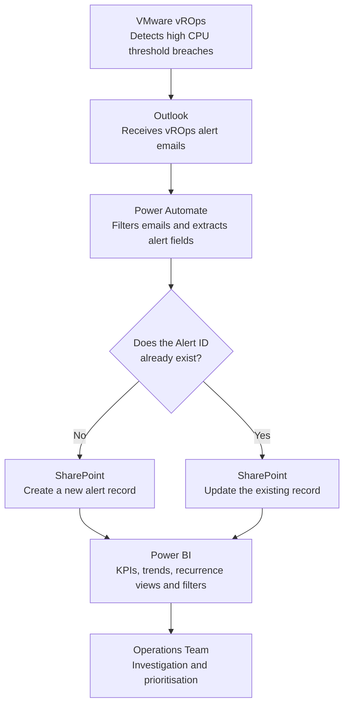

# SDDC CPU Alert Intelligence & Operational Analytics

## Project overview

This project demonstrates an automated infrastructure alert-processing and operational analytics workflow built around VMware vRealize Operations (vROps), Microsoft Power Automate, SharePoint and Power BI.

The solution processes CPU threshold alerts generated for VMware Software-Defined Data Center (SDDC) edge virtual machines. It transforms alert emails into structured records, maintains the latest alert state and severity, and presents operational insights through a Power BI dashboard.

## Business problem

Infrastructure monitoring generates alert notifications, but email-based alerts are difficult to consolidate and analyse consistently.

The solution addresses this by introducing an automated workflow that:

- Processes qualifying infrastructure alert emails.
- Extracts relevant alert information into structured fields.
- Identifies alerts using their Alert ID.
- Updates existing records when an alert changes.
- Provides a centralised data source for operational reporting.
- Presents alert trends and operational insights through Power BI.

## Architecture

## Component responsibilities

### 1. VMware vROps — Monitoring and alert generation

- Monitors SDDC edge virtual machines.
- Detects high CPU threshold breaches.
- Generates alert notifications containing relevant alert information.

### 2. Outlook — Alert intake

- Receives alert emails generated by VMware vROps.
- Acts as the input source monitored by Power Automate.

### 3. Power Automate — Workflow and processing

The workflow monitors qualifying emails and extracts:

- SDDC
- Tenant
- Virtual machine
- CPU utilisation
- Alert ID
- Severity
- State
- Timestamp

It then checks the Alert ID to determine whether the incoming notification represents a new alert or an update to an existing alert.

### 4. SharePoint — Structured alert repository

SharePoint stores the extracted alert information as structured records.

The processing logic is based on Alert ID:

**New Alert ID**
- Creates a new SharePoint record.

**Existing Alert ID**
- Updates the matching SharePoint record.
- Updates severity when severity changes.
- Updates state when state changes, including transitions such as Active to Cleared.
- Reuses the existing record rather than creating a duplicate, provided the incoming notification contains the same Alert ID.

This maintains the latest known state of each identified alert.

### 5. Power BI — Operational analytics

Power BI consumes the structured SharePoint data and provides:

- Key performance indicators.
- Alert trends.
- Recurrence views.
- Severity analysis.
- Interactive filtering.

### 6. Operations team — Operational decision support

The operations team uses the dashboard to identify and prioritise infrastructure issues requiring investigation and corrective action.

## Data flow

1. VMware vROps detects a high CPU threshold breach on an SDDC edge VM.
2. vROps generates an alert email.
3. Outlook receives the notification.
4. Power Automate processes the qualifying email.
5. The workflow extracts the alert attributes.
6. Power Automate checks the Alert ID against existing SharePoint records.
7. A new Alert ID creates a new record.
8. An existing Alert ID updates the matching record, including severity and state.
9. Power BI consumes the structured SharePoint data.
10. Operations personnel use the dashboard for analysis and prioritisation.

## Technology stack

| Technology | Role |
|---|---|
| VMware vROps | Infrastructure monitoring and alert generation |
| Microsoft Outlook | Alert email intake |
| Microsoft Power Automate | Workflow automation and data extraction |
| Microsoft SharePoint | Structured alert data storage |
| Microsoft Power BI | Operational analytics and visualisation |

## Architecture considerations

### Alert identity and record matching

Alert ID is the matching key used to identify whether an incoming notification belongs to a new or existing alert.

### Current-state management

The SharePoint record is updated when severity or state changes. The design therefore represents the latest known state of an alert.

### Historical audit limitation

Because updates overwrite the existing record, a complete history of every severity or state transition should not be assumed. A separate event-history mechanism would be required if historical transition auditing is a requirement.

### Data protection

This public case study intentionally describes the architecture without exposing internal SDDC names, tenant identifiers, virtual machine names, actual alert IDs, internal email content or company-specific operational information.

## Project value

The solution connects infrastructure monitoring, workflow automation, structured data management and operational analytics.

It demonstrates how infrastructure alert notifications can be transformed into a structured operational information source, reducing reliance on manual email review and enabling more consistent alert analysis.

## Skills demonstrated

- VMware infrastructure monitoring
- SDDC operations
- Alert processing and correlation
- Microsoft Power Automate
- SharePoint data management
- Power BI reporting and analytics
- Infrastructure automation
- Operational workflow design
- Enterprise infrastructure architecture

---

*This case study describes the workflow and design principles. No performance improvements, time savings or other quantitative outcomes are claimed because verified measurements have not been provided.*
